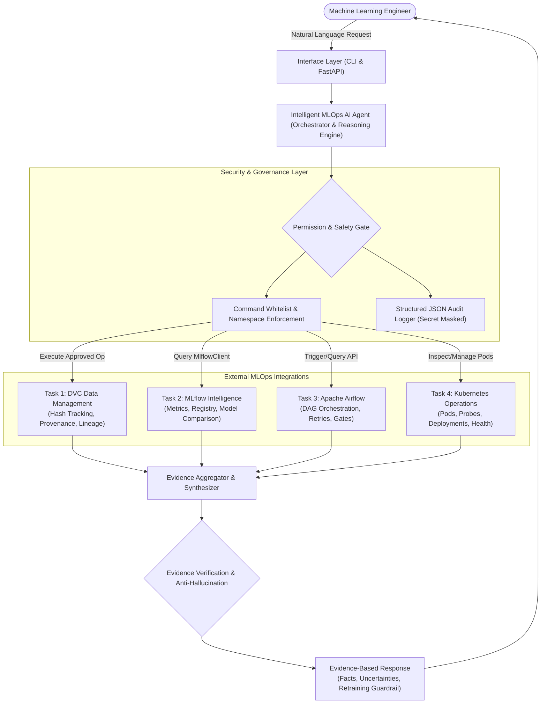
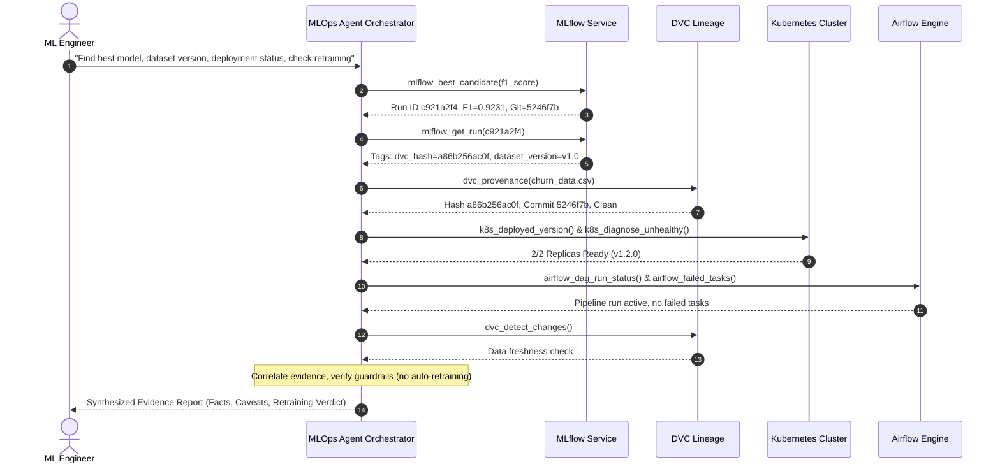

# System Architecture: Production MLOps AI Agent

This document outlines the complete architectural design, execution workflows, security models, and integration patterns of the **Intelligent MLOps AI Agent**.

---

## 1. High-Level Logical Architecture

The system is designed according to the canonical MLOps closed-loop operational framework. Rather than acting as a hallucinating text generator, the agent functions as a **deterministic operational orchestrator** backed by structured evidence.



---

## 2. Core Functional Modules

### Task 1 — DVC Data Management Agent
- **Purpose**: Provides dataset versioning, immutable hash provenance, and reproducible dataset state checkout.
- **Tools**:
  - `list_tracked_datasets`: Scans repository `.dvc` files and detects modified data.
  - `get_dataset_provenance`: Maps current dataset files to MD5 hashes, Git commits, and remote storage targets.
  - `compare_dataset_versions`: Compares dataset hashes across releases and detects drift or structural changes.
  - `detect_data_changes`: Compares working tree file hashes against recorded DVC pointer files.
  - `explain_reproduction`: Generates deterministic Git and DVC checkout command sequences.
- **Safety Restriction**: Subprocess execution is strictly limited to an approved command set (`status`, `diff`, `checkout`, `pull`, `push`, `root`, `list`, `version`, `repro`). Arbitrary system shell commands are blocked by policy.

### Task 2 — MLflow Experiment Intelligence Agent
- **Purpose**: Tracks experiments, extracts hyperparameters and evaluation metrics, identifies optimal model candidates, and queries the model registry.
- **Tools**:
  - `list_experiments` & `list_runs`: Enumerates active experiments and recent training runs using `MlflowClient`.
  - `get_run_details`: Extracts metrics (`f1_score`, `accuracy`, `latency_ms`), parameters, tags (`dvc_dataset_hash`, `git_commit`), and artifacts.
  - `get_best_run`: Multi-attribute candidate selection. Enforces quality gates (e.g. `min_f1_threshold >= 0.70`, SLA latency <= 50ms) rather than blindly prioritizing raw metric maximums.
  - `compare_runs`: Generates side-by-side metric comparison tables across arbitrary runs.
  - `get_model_registry_details`: Inspects registered model versions, production stages, and candidate statuses.

### Task 3 — Apache Airflow Workflow Agent
- **Purpose**: Manages and monitors DAG lifecycle, task retries, downstream dependencies, and failure diagnostics.
- **Pipeline Architecture**:
  ```mermaid
  flowchart LR
      V[validate_dataset] --> P[preprocess_data]
      P --> T[train_model]
      T --> E[evaluate_and_log_mlflow]
      E --> Q{apply_model_quality_gate}
      Q -->|Passed| Deploy[Approved for Production]
      Q -->|Failed| Halt[Downstream Promotion Halted]
  ```
- **Tools**:
  - `list_dags`: Enumerate active pipeline DAGs.
  - `get_dag_run_status`: Track execution states (`running`, `success`, `failed`).
  - `trigger_training_dag`: Triggers authorized training DAGs via authenticated REST calls.
  - `get_failed_tasks`: Isolates tasks that raised unhandled exceptions.
  - `get_task_diagnostics`: Retrieves execution logs, root cause categorization (`QualityGateThresholdFailure`), and resolution recommendations.

### Task 4 — Kubernetes Operations Agent
- **Purpose**: Observes and maintains the containerized FastAPI prediction microservice in Kubernetes clusters.
- **Architecture**:
  - `Deployment`: 2 desired replicas, rolling update strategy, CPU/Memory resource requests and limits.
  - `Probes`: Liveness probe (`/health` on port 8000) and Readiness probe (`/health` on port 8000).
  - `Service`: Internal `ClusterIP` routing traffic to healthy pods.
  - `ConfigMap`: Decoupled non-sensitive environment configuration.
- **Tools**:
  - `list_pods` & `list_deployments`: Inspects replica counts and container phases.
  - `get_pod_status_and_logs`: Collects recent container standard error/output.
  - `diagnose_unhealthy_pods`: Automatically flags pods in `CrashLoopBackOff` or `OOMKilled` and traces root cause.
  - `get_deployed_application_version`: Identifies running container images and semantic versions.
  - `execute_cluster_state_change`: Manages cluster mutations with **mandatory user confirmation** and **namespace whitelisting**.

---

## 3. Integration & Multi-Tool Reasoning (Task 5)

When presented with complex composite requests (e.g., *"Find the best recent model, identify the dataset version used to train it, check the deployment status, and explain whether retraining is necessary"*), the agent executes an evidence correlation workflow:



### Safety Policy: Retraining Guardrail
Retraining is **never initiated automatically** without explicit operator approval. The agent recommends retraining only when presented with concrete empirical evidence:
1. Failed automated quality gate (`quality_gate: FAILED`),
2. Detected dataset drift or updated raw data versions (`has_changes: True`),
3. Explicit freshness policy breach.

If cluster failure is diagnosed as infrastructure-related (e.g. `CrashLoopBackOff` due to missing dependency or configuration error), retraining is explicitly **discouraged**, directing operator attention to infrastructure remediation.

---

## 4. Security, Reliability & Audit Logging

1. **Non-Root Execution**: Containerized services run as unprivileged `mlops` user (UID 10001).
2. **Secret Masking**: Structured JSON logs record `timestamp`, `request_id`, `tool_name`, `status`, `duration_ms` while actively filtering passwords, tokens, and authorization headers.
3. **Anti-Hallucination Guarantee**: When an external service is unavailable or unreachable, the agent records an explicit uncertainty rather than inventing plausible metrics.
