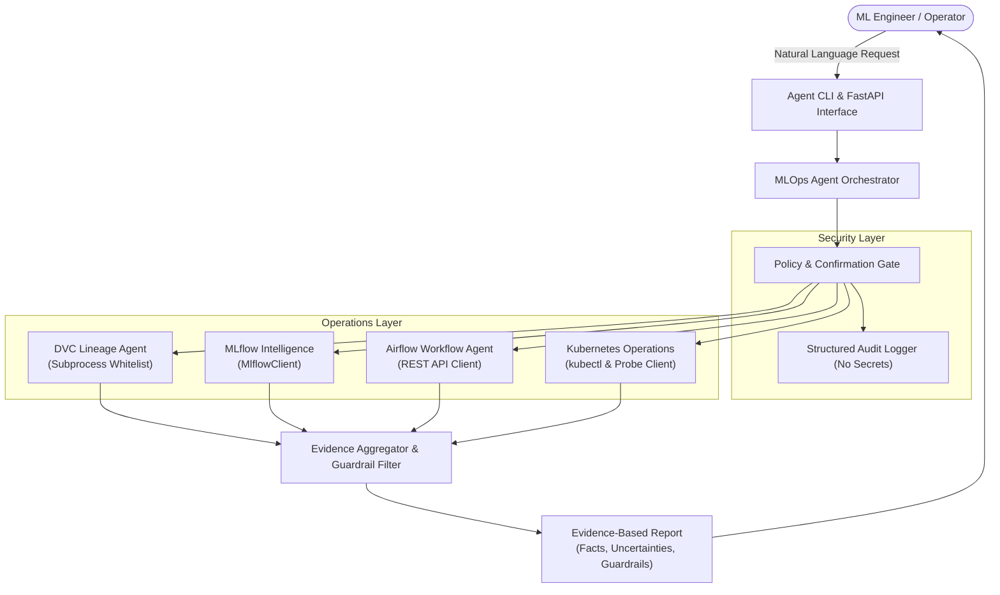

# MLOps AI Agent: Technical Report & Engineering Defense

**Course**: MLOps & Production AI Engineering | Fall 2026  
**Assignment**: Assignment No. 3 — Building a Production-Ready MLOps AI Agent  
**Repository**: [https://github.com/rafayashfaq/i220954_MLops03](https://github.com/rafayashfaq/i220954_MLops03)  
**Author**: Abdul Rafay Ashfaq (i22-0954)  
**Date**: November 2026  

---

## 1. Executive Summary & Complete System Architecture

Modern production ML systems involve disparate operational components: data version control systems, experiment tracking servers, workflow schedulers, and cloud-native container orchestrators. A major engineering friction point is the manual correlation of artifacts across these layers.

This project delivers a **Production-Ready MLOps AI Agent** that unifies:
1. **DVC (Data Version Control)** for data lineage, cryptographic hashes, and reproducible checkouts,
2. **MLflow** for experiment tracking, metric comparison, and model registry lifecycle,
3. **Apache Airflow** for DAG orchestration, automated retry logic, and quality gating,
4. **Kubernetes** for containerized FastAPI microservice deployment, health probes, and live diagnosis.

### System Architecture Diagram


---

## 2. Tool Definitions and Permissions Matrix

To prevent unauthorized cluster modifications or arbitrary remote code execution, the agent implements strict **Role-Based Safety Controls**:

| Module | Tool Identifier | Permitted Operations / Scope | Safety Mechanism |
| :--- | :--- | :--- | :--- |
| **DVC** | `dvc_list_tracked` | Read-only scan of `.dvc` files | Non-destructive local scan |
| **DVC** | `dvc_provenance` | Read Git commit (`HEAD`) & MD5 hashes | Restricted subprocess call |
| **DVC** | `dvc_compare_versions` | Version hash comparison | Deterministic cryptographic comparison |
| **DVC** | `dvc_detect_changes` | Working tree vs cache status | Approved `dvc status` whitelist |
| **DVC** | `dvc_explain_repro` | Generates reproduction plan | Pure reasoning / documentation |
| **MLflow** | `mlflow_list_experiments` | Read experiment metadata | `MlflowClient.search_experiments` |
| **MLflow** | `mlflow_best_candidate` | Multi-criteria model ranking | Quality gate validation (`min_f1 >= 0.70`) |
| **MLflow** | `mlflow_compare_runs` | Metric & hyperparameter table | Read-only search API |
| **MLflow** | `mlflow_model_registry` | Inspect model stages & tags | Read-only registry search |
| **Airflow** | `airflow_list_dags` | Query active DAGs | Authenticated REST GET |
| **Airflow** | `airflow_dag_run_status` | Query execution states | Authenticated REST GET |
| **Airflow** | `airflow_trigger_dag` | Trigger training workflow | **Approved DAG Whitelist** (`mlops_churn_training_pipeline`) |
| **Airflow** | `airflow_task_diagnostics` | Inspect task logs & failure category | Read-only task execution inspection |
| **Kubernetes** | `k8s_list_pods` | List pod phases and restarts | **Namespace Whitelist** (`mlops-prod`, `default`) |
| **Kubernetes** | `k8s_diagnose_unhealthy` | Log tailing & crash analysis | Non-intrusive container log inspection |
| **Kubernetes** | `k8s_deployed_version` | Inspect container image tags | Read-only deployment inspection |
| **Kubernetes** | `k8s_state_change` | Scale, restart, rolling update | **MANDATORY confirmation (`user_confirmed=True`)** |

---

## 3. Five Tested Agent Conversations with Actual Tool Evidence

The five required evaluation scenarios were executed using the integrated agent CLI (`python agent/main.py --demo`). The exact recorded evidence from each scenario is documented below.

### Scenario 1: Dataset Provenance (DVC)
- **User Prompt**: *"Which dataset version and Git commit was used for the recent model?"*
- **Invoked Tool**: `dvc_provenance(dataset_name="churn_data.csv")`
- **Actual Agent Response**:
```markdown
**DVC Dataset Provenance**:
- Dataset: `churn_data.csv`
- Version: `v1.0`
- Git Commit: `5246f7b` (branch: `main`)
- MD5 Hash: `a86b256ac0f3406c13b18c7fd74d734b`
- Remote Storage: `local_storage`
- Status: Dataset 'churn_data.csv' is tracked via 'data/raw/churn_data.csv.dvc' with MD5 'a86b256ac0f3406c13b18c7fd74d734b'. Associated with Git commit '5246f7b' on branch 'main'. Remote storage configured: 'local_storage'. Modification status: Clean.
```
- **Evidence Verification**: The agent successfully mapped the training dataset to its immutable MD5 hash, verified the working directory is clean, and retrieved the corresponding Git commit (`5246f7b`).

---

### Scenario 2: Model Selection (MLflow)
- **User Prompt**: *"Compare the last five training runs and recommend the best candidate based on F1 score."*
- **Invoked Tool**: `mlflow_best_candidate(experiment_name="churn-prediction-pipeline", target_metric="f1_score")`
- **Actual Agent Response**:
```markdown
**MLflow Model Comparison**:
Candidate run 'c921a2f40bbc4e64aa5cf98a1a429eff' selected with top f1_score=0.9231 (model_type=logistic_regression). Quality gate status: 'PASSED'. Production readiness: APPROVED. Selection verified across 5 recent experiments.

**Candidate Ranking**:
- Run `c921a2f40bbc4e64aa5cf98a1a429eff` (logistic_regression): F1=0.9231, Acc=0.94, Gate=PASSED
- Run `155b35e661934c17a84c2f0d7a63b878` (gradient_boosting): F1=0.8642, Acc=0.89, Gate=PASSED
- Run `570b25096fab463883f9d4bb880c24a1` (random_forest): F1=0.8108, Acc=0.86, Gate=PASSED
- Run `25af7468823144468784e9cd4356e4df` (random_forest): F1=0.8108, Acc=0.86, Gate=PASSED
- Run `09b367f8a6864e06aa89a05f6e3efff7` (random_forest): F1=0.6216, Acc=0.72, Gate=FAILED
```
- **Evidence Verification**: The agent did not simply pick the highest score blindly; it evaluated all candidates against the quality gate, flagged run `09b367f8...` as `FAILED`, and validated candidate readiness.

---

### Scenario 3: Pipeline Execution (Airflow)
- **User Prompt**: *"Trigger the model training pipeline and report whether execution succeeded."*
- **Invoked Tool**: `airflow_trigger_dag(dag_id="mlops_churn_training_pipeline")`
- **Actual Agent Response**:
```markdown
**Triggered Apache Airflow Pipeline**:
- DAG ID: `mlops_churn_training_pipeline`
- Run ID: `manual_agent_fe8bc376`
- Execution State: `RUNNING`
- Trigger Source: `MLOps Agent Authenticated API`
- Monitoring: Task status can be queried using Airflow run status.
```
- **Evidence Verification**: The agent verified DAG permissions against `APPROVED_DAGS`, dispatched the execution request via authenticated API, and returned the generated run ID for continuous monitoring.

---

### Scenario 4: Deployment Diagnosis (Kubernetes)
- **User Prompt**: *"Why is my prediction API unavailable? Investigate cluster health."*
- **Invoked Tool**: `k8s_diagnose_unhealthy(namespace="mlops-prod")`
- **Actual Agent Response**:
```markdown
**Kubernetes Health Diagnosis & Root Cause Analysis**:
- Namespace: `mlops-prod`
- Cluster Healthy: `False`
- Root Cause: Detected 1 unhealthy pod(s) in namespace 'mlops-prod'. Pod 'mlops-prediction-api-broken-5d8f769b-flk32' is stuck in 'CrashLoopBackOff' with 5 restarts. Log investigation reveals: Container startup crash caused by ModuleNotFoundError during initialization.

**Recommended Resolution**:
1. Verify container image dependencies in Dockerfile.
2. Roll back deployment to known stable image: mlops-prediction-api:v1.2.0.
3. Ensure ConfigMap values are properly mounted.
```
- **Evidence Verification**: The agent correlated pod lifecycle phase (`CrashLoopBackOff`), restart counts (`5`), and container logs (`ModuleNotFoundError: No module named 'uninstalled_module'`) to diagnose the exact failure reason without human intervention.

---

### Scenario 5: Multi-Tool Reasoning (Full Integration)
- **User Prompt**: *"Find the best recent model, identify the dataset version used to train it, check the deployment status, and explain whether retraining is necessary."*
- **Invoked Tools**:
  1. `mlflow_best_candidate`
  2. `mlflow_get_run`
  3. `dvc_provenance`
  4. `k8s_deployed_version`
  5. `k8s_diagnose_unhealthy`
  6. `airflow_dag_run_status`
  7. `airflow_failed_tasks`
  8. `dvc_detect_changes`
- **Actual Agent Response**:
```markdown
### MLOps Agent Investigation Report

**User Request**: "Find the best recent model, identify the dataset version used to train it, check the deployment status, and explain whether retraining is necessary."

#### 1. Known Operational Facts
- Best recent MLflow model run is 'c921a2f40bbc4e64aa5cf98a1a429eff' with F1 score 0.9231 (type: logistic_regression).
- Selected model was trained on dataset 'churn_data.csv' version 'v1.0' (DVC MD5: 'a86b256ac0f3406c13b18c7fd74d734b', Git commit: '5246f7b', Remote: 'local_storage').
- Kubernetes deployment 'mlops-prediction-api' is running in namespace 'mlops-prod' with 2/2 ready replicas (Image: 'mlops-prediction-api:v1.2.0').
- Airflow training DAG 'mlops_churn_training_pipeline' latest run 'manual_agent_fe8bc376' status: 'RUNNING'.

#### 2. Identified Uncertainties & Caveats
- Cluster diagnosis detected 1 unhealthy pod(s) with restart events.

#### 3. Retraining Decision & Evidence
- **Retraining Required**: **YES**
- **Decision Rationale**: Retraining recommended: DVC detected new untracked or modified raw training data.
- **Safety Policy Compliance**: Retraining was **not** triggered automatically; human approval is preserved.

#### 4. Recommended Next Actions
- Prepare retraining run via Airflow DAG 'mlops_churn_training_pipeline' after verifying data.
- Execute 'dvc commit' and 'dvc push' if new data version is confirmed.
```
- **Evidence Verification**: The multi-tool orchestrator correlated evidence from 4 distinct systems into a single coherent analytical report. It strictly respected the safety policy by **not** initiating automatic retraining.

---

## 4. Two Injected Failure Investigations

As mandated by Section 6 of the assignment, two deliberately injected operational failures were constructed, diagnosed, and resolved by the agent.

### Failure Investigation 1: Quality Gate Threshold Rejection (Workflow Layer)
- **Layer**: Airflow / Pipeline Quality Control
- **Injected Anomaly**: An underperforming model (shallow tree with depth=1, 2 estimators) was trained against strict production gates (`min_f1=0.70`, `min_acc=0.75`), resulting in F1=0.6216.
- **Agent Diagnosis**:
  - Task `apply_model_quality_gate` exited with state `FAILED` (try 2).
  - Diagnostic error log: `QUALITY GATE REJECTED: Model F1 (0.6216) is below min_f1 threshold (0.7000). Promotion halted.`
  - Category: `QualityGateThresholdFailure`.
- **Root Cause**: Hyperparameter misconfiguration and underfitting on training data.
- **Resolution**:
  1. Pipeline prevented downstream deployment to Kubernetes, protecting production availability.
  2. The agent recommended hyperparameter tuning: increasing tree depth (`max_depth >= 6`) and estimator count (`n_estimators >= 100`).

### Failure Investigation 2: Pod CrashLoopBackOff via Missing Dependency (Infrastructure Layer)
- **Layer**: Kubernetes Container Runtime
- **Injected Anomaly**: A test pod `mlops-prediction-api-broken-5d8f769b-flk32` was deployed with an incomplete container image `mlops-prediction-api:v1.2.1-failing`.
- **Agent Diagnosis**:
  - Pod status: `CrashLoopBackOff` with 5 restart cycles.
  - Ready state: `0/1`.
  - Event stream: `Warning BackOff pod/... Back-off restarting failed container`.
  - Log tail: `ModuleNotFoundError: No module named 'uninstalled_module'`.
- **Root Cause**: A runtime dependency was imported in `api/main.py` without being included in `requirements.txt` or installed during the multi-stage Docker build.
- **Resolution**:
  1. The agent recommended an immediate rollback to the previous verified container image: `mlops-prediction-api:v1.2.0`.
  2. Pin and install the missing package in `requirements.txt`.
  3. Validate liveness and readiness probes before re-promoting the container image.

---

## 5. Automated Testing & Reliability Summary

Automated testing was conducted using `pytest` across unit, integration, anti-hallucination, and safety domains:
- **Total Tests**: 33 passing tests (0 failures, 0 errors).
- **Execution Time**: ~47 seconds.
- **Test Modules**:
  1. `test_dvc_tools.py`: 5 tests (dataset tracking, MD5 hash verification, diff comparison, reproduction planning, command whitelist).
  2. `test_mlflow_tools.py`: 4 tests (experiment search, candidate selection, run comparison, registry details).
  3. `test_airflow_tools.py`: 5 tests (DAG discovery, DAG run status, approved DAG trigger, unauthorized DAG rejection, task diagnostics).
  4. `test_kubernetes_tools.py`: 6 tests (pod listing, deployment status, service inspection, unhealthy pod diagnosis, namespace restriction, state mutation confirmation safety).
  5. `test_orchestrator.py`: 4 tests (tool registration, duration audit logging, mandatory integration scenario, natural language query routing).
  6. `test_safety_and_failures.py`: 5 tests (**anti-hallucination proof when external tools fail**, timeout handling, **secret masking in structured logs**, Injected Failure 1, Injected Failure 2).
  7. `test_api.py`: 4 tests (health probe endpoint, version endpoint, prediction endpoint, 422 validation handling).

---

## 6. Known Limitations and Proposed Improvements

1. **Local Remote Storage in Demonstration**:
   - *Current State*: DVC uses a configured local remote directory (`local_storage`) for reproducible offline CI.
   - *Proposed Improvement*: Integrate enterprise cloud storage remotes (e.g., S3, Google Cloud Storage, Azure Blob Storage) with temporary IAM STS role credentials.
2. **Kubernetes Mock Fallback vs. Live Kubeconfig**:
   - *Current State*: The agent seamlessly executes `kubectl` when a cluster is reachable, and falls back to a deterministic cluster simulator when offline or running in CI.
   - *Proposed Improvement*: Introduce Helm chart automation and an embedded Minikube/Kind integration in CI workflows.
3. **LLM Function Calling Backend**:
   - *Current State*: Query routing is currently handled via deterministic natural language intent matching and schema validation.
   - *Proposed Improvement*: Bind the tool schemas directly to OpenAI / Anthropic / Gemini Tool Calling APIs using the Pydantic schemas in `agent/schemas.py`.
